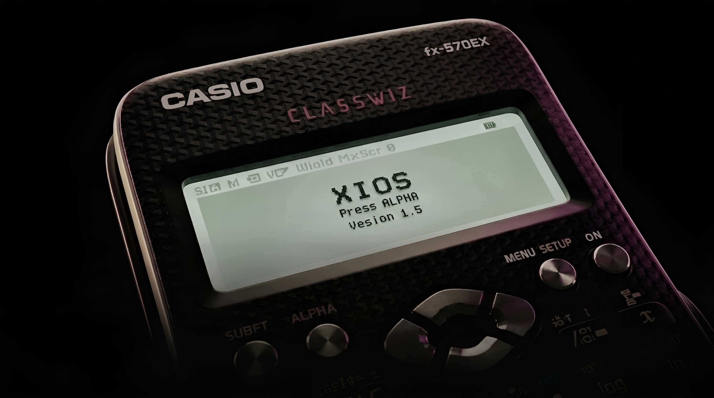

# XIOS 🚀
> **The Ultimate Custom Operating System for Casio FX-570EX & FX-991EX (Powered by Raspberry Pi Pico)**

---

## 🌟 Overview
**XIOS** is a lightweight, high-performance custom operating system designed to transform your **Casio FX-570EX** and **FX-991EX** calculators into versatile handheld devices. Powered by the **Raspberry Pi Pico**, XIOS delivers a buttery-smooth experience with minimal bloatware.

---

## ✨ Key Features

* **⚡ Ultra-Fast Text & Document Viewer**
  * Read `.txt` files effortlessly without any lag.
  * Super responsive and quick loading times for your documents.

* **🎮 Built-in Retro Games**
  * **Snake:** The classic game to pass the time.
  * **Tetris:** Test your block-stacking skills directly on your calculator!

* **🧹 Minimalist & Lightweight**
  * **Minimal Bloatware:** Built strictly with essential features for maximum speed.
  * **Clean UI:** Simple, intuitive, and distraction-free interface.

* **💡 Pico Powered**
  * Fully leverages the processing power and memory of the Raspberry Pi Pico.

---

## 🚀 Quick Setup

1. **Connect** your Raspberry Pi Pico to your PC.
2. **Wire/Assemble** the hardware to your FX-570EX / FX-991EX calculator.
3. **Flash** the XIOS firmware (`.uf2`) onto the Pico.
4. Power up and enjoy XIOS!

---

## 🤝 Community & Support

> **Thanks for using XIOS!** Join our growing community to get the latest updates, technical support, or just to chat with fellow XIOS users:

---

Made with ❤️ for the FX-570EX & FX-991EX Modding Community

